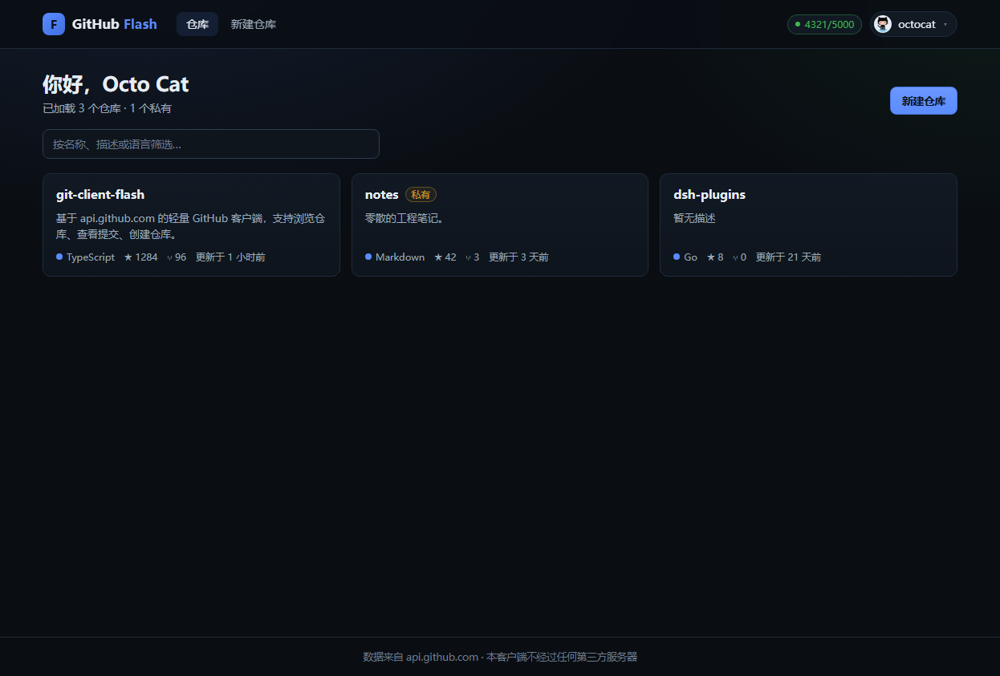
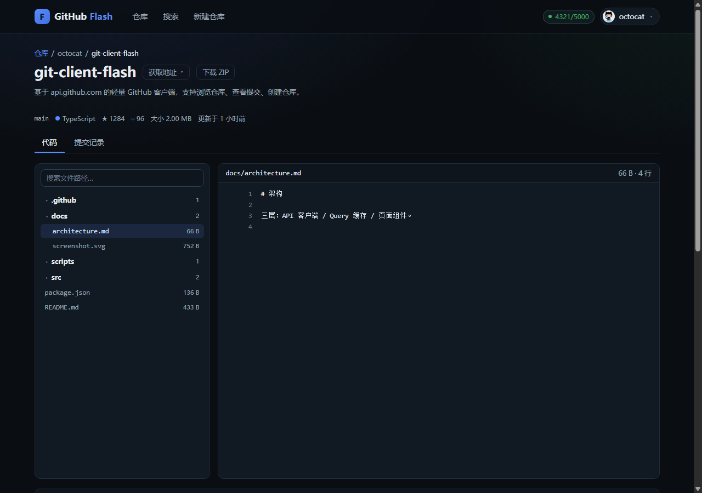
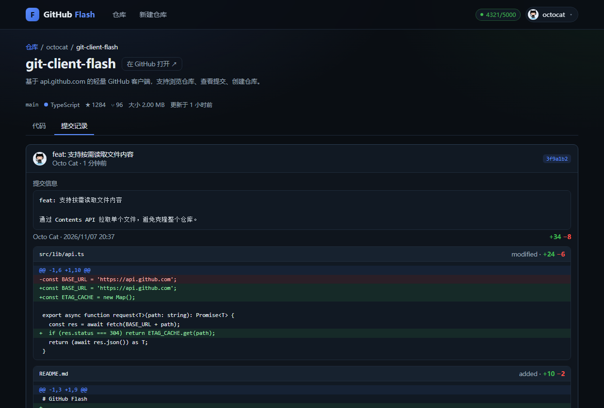
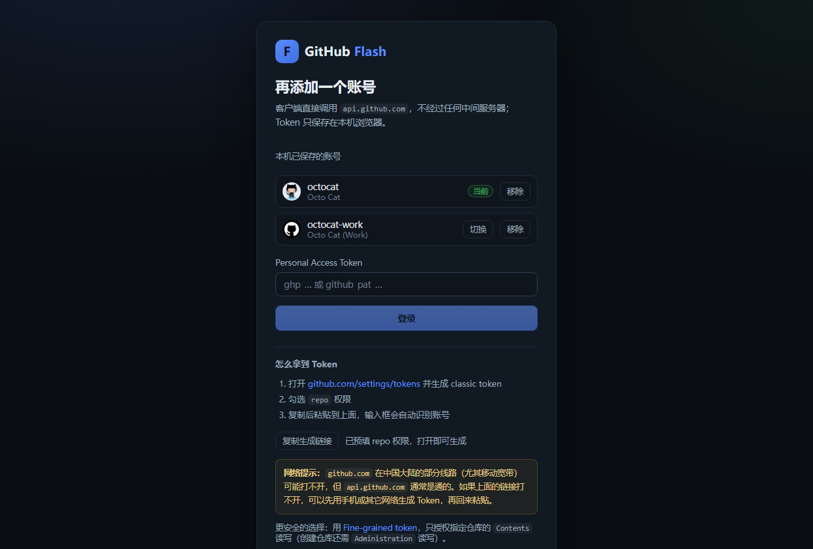
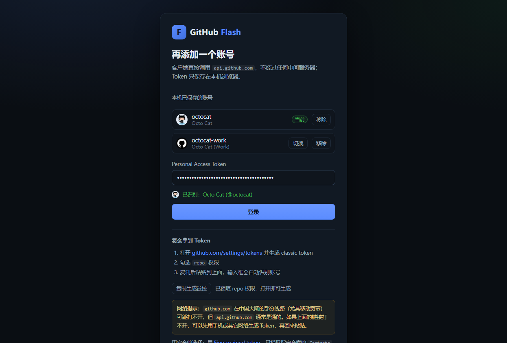
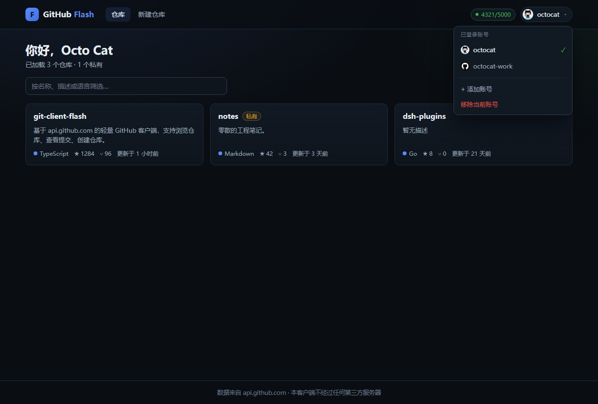
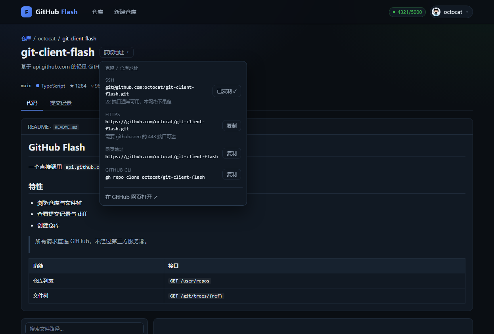

# GitHub Flash

一个直接调用 `api.github.com` 的轻量 GitHub 客户端：浏览仓库、读取文件、查看提交记录、创建仓库。
前端直连 GitHub REST API，**不经过任何第三方服务器**，也没有自建后端。

## 界面

| 仓库列表 | 文件浏览与代码查看 |
| --- | --- |
|  |  |

| 提交记录与 diff | 登录（多账号） |
| --- | --- |
|  |  |

| Token 实时校验 | 账号切换 |
| --- | --- |
|  |  |

| 获取仓库地址（HTTPS / SSH / gh CLI） |
| --- |
|  |

## 为什么用 `api.github.com`

在中国大陆的部分线路（尤其移动宽带）上，`github.com` 的 443 端口会被定向阻断，但 `api.github.com`
通常可正常访问（实测 p50 约 60ms）。客户端只依赖 API 域名，因此网页打不开时依然能用。

## 快速开始

```bash
npm install
npm run dev          # http://127.0.0.1:5273
```

构建：

```bash
npm run build        # 类型检查 + 产物输出到 dist/
npm run preview
```

## 离线 / 无 Token 调试（mock 模式）

本地跑一个 GitHub 形状的假接口，界面功能可以完整点通：

```bash
npm run mock                                    # 终端 A，监听 8799
VITE_API_BASE=http://127.0.0.1:8799 npm run dev  # 终端 B
```

此时任意 Token 都能登录。`VITE_API_BASE` 也可指向自建反代，用于在 GitHub 连通性差的网络下加速。

## 测试

```bash
npm run smoke        # 打包 API 层并真实请求 api.github.com，验证鉴权 / 分页 / ETag / diff
```

需要网络可达 `api.github.com`，会消耗少量未认证配额（约 7 次）。

## 登录

### 为什么不用用户名 / 密码

GitHub 自 **2020-11-13** 起对所有账号**永久停止**了 REST API 的密码认证（[官方说明](https://docs.github.com/en/rest/overview/other-authentication-methods)），
任何第三方客户端都必须使用 Token：

- 密码认证已不可用，`api.github.com` 直接返回 401；
- OAuth / Device Flow 的端点都在 `github.com` 上，本项目面向的网络里该域名不可达；
- 浏览器直连 Device Flow 还会被 CORS 拦（GitHub 不返回相应响应头，官方要求必须有服务端进程）。

所以纯前端 + `api.github.com` 的组合下，PAT 是唯一可行方案。想要"点一下就登录"，需要改桌面壳（Tauri/Electron）+ Device Flow，或自建 OAuth 中转后端。

### 使用方式

1. 打开 <https://github.com/settings/tokens/new?scopes=repo>（页面内有「复制生成链接」按钮）
2. 勾选 `repo` 权限，生成后复制
3. 粘贴到登录框——**输入框会实时校验并显示识别到的账号**，确认无误再点登录

登录相关的行为：

| 能力 | 说明 |
| --- | --- |
| 实时校验 | 输入形似 PAT 的字符串时（前缀 `ghp_`/`github_pat_` 等），600ms 防抖后调 `/user` 预检，显示头像和 `@login` |
| 多账号 | 可保存多个 Token，右上角头像处一键切换；切换时清空查询缓存，避免串号 |
| 失效自动降级 | 任意请求返回 401 会剔除该账号并回落到下一个账号，同时提示"Token 已失效" |
| 网络容错 | 启动时若只是网络不通（非 401），保留登录态进入应用，由页面展示错误态，不会把你踢回登录页 |

Token 存在浏览器 `localStorage`：`gh-flash:accounts`（账号数组）、`gh-flash:active`（当前账号）。

> 生产环境建议改为桌面壳（Tauri/Electron）存系统钥匙串，避免 XSS 读取 Token。

## 已实现功能

| 功能 | 接口 |
| --- | --- |
| 仓库列表（分页 + 本地筛选） | `GET /user/repos` |
| 仓库详情 | `GET /repos/{owner}/{repo}` |
| 文件树 | `GET /repos/{owner}/{repo}/git/trees/{ref}?recursive=1` |
| 文件内容 | `GET /repos/{owner}/{repo}/contents/{path}` |
| README 渲染 | `GET /repos/{owner}/{repo}/readme` |
| 提交列表（分页） | `GET /repos/{owner}/{repo}/commits` |
| 提交详情 + diff | `GET /repos/{owner}/{repo}/commits/{sha}` |
| 仓库地址（HTTPS / SSH / gh CLI，一键复制） | 由 `full_name` 与 `html_url` 拼装，无需额外请求 |
| 创建仓库 | `POST /user/repos` |

## 工程要点

- **ETag 条件请求缓存**：重复浏览返回 `304`，不消耗 API 配额，二级页几乎零延迟。
- **配额可视化**：订阅 `x-ratelimit-*` 响应头，顶栏实时显示剩余额度；`403 + remaining=0` 会渲染成"配额用完"并给出重置时间。
- **错误分类**：`GitHubError` 区分 `auth / rate-limit / forbidden / not-found / validation / network`，每类有对应文案与操作建议。
- **自动重试**：网络错误与 5xx 退避重试 2 次；`401` 直接清理 Token 回到登录页，不做无意义重试。
- **XSS 防护**：README 属于不可信输入，`marked` 渲染后再用 DOM 白名单清洗（去脚本、去 `on*`、限制 `javascript:` 协议）。
- **大文件保护**：超过 4000 行 / 40 万字符不渲染，避免卡死页面。

## 已知限制

- **不是 git 客户端**：不能 clone / push / merge。真正传输代码请用 SSH（`git@github.com`，22 端口在本网络可用）。
- **单文件上限**：Contents API 1MB，更大的需走 Blobs API（≤100MB）；不支持 Git LFS。
- **文件树上限**：`trees?recursive=1` 最多 10 万条目 / 7MB 响应，超大仓库会返回 `truncated: true`。
- **未认证配额 60 次/小时且按出口 IP 计**，移动宽带 CGNAT 下会被邻居共享耗尽，因此必须登录。
- **OAuth 登录不可用**：GitHub 的 OAuth/Device Flow 端点在 `github.com` 上，本网络无法访问，故采用 PAT。

## 目录结构

```
src/
  lib/
    api.ts        # 请求核心：鉴权、ETag、重试、限流、错误分类、分页
    auth.tsx      # Token 上下文与登录状态
    markdown.ts   # README 渲染 + 清洗
    format.ts     # 时间 / 体积 / sha 格式化
    types.ts      # GitHub REST 响应类型
  components/
    Layout.tsx    # 顶栏、配额徽标、导航
    RepoCard.tsx
    FileBrowser.tsx
    CommitList.tsx
    State.tsx     # 加载 / 错误 / 空态 / 骨架屏
  pages/
    Login.tsx
    Repos.tsx
    Repo.tsx
    NewRepo.tsx
```
